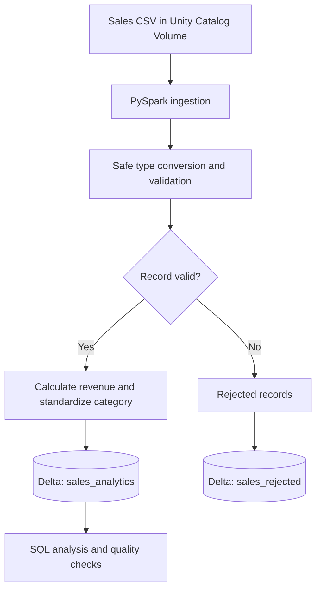

# Databricks Sales Data Engineering Pipeline

A data engineering learning project built with **Databricks Free Edition**, **PySpark**, **Unity Catalog**, and **Delta Lake**. It ingests a sales CSV, validates and cleans records, calculates revenue, stores valid and rejected data separately, and performs category-level analysis.

## Results

| Metric | Result |
|---|---:|
| Source records | 1,000 |
| Valid records | 988 |
| Rejected records | 12 |
| Valid-record retention | 98.8% |

Revenue is calculated as `quantity * unit_price`. The source dataset does not specify a currency, so revenue is reported in the source price units.

## Architecture



See [`architecture.md`](architecture.md) for more detail.

## Technology Stack

- Databricks Free Edition
- Python and PySpark
- Unity Catalog volume for source-file storage
- Delta Lake tables
- Spark SQL

## Data Quality Rules

A record is rejected when its order ID is invalid or missing, quantity is missing/invalid/zero/negative, unit price is missing/invalid/NaN/negative, or order date is missing/invalid. Safe conversions allow malformed values to be identified without stopping the entire pipeline.

For valid records, the pipeline calculates `revenue = quantity * unit_price`. Category names are trimmed and standardized for capitalization; missing categories are labeled `Unknown`.

## Output Tables

| Table | Purpose |
|---|---|
| `workspace.default.sales_analytics` | Valid sales rows with calculated revenue and standardized categories |
| `workspace.default.sales_rejected` | Rows that failed validation and are retained for review |

## Final Validation

The notebook verified the saved table counts:

- `sales_analytics`: 988 records
- `sales_rejected`: 12 records

The final revenue-quality query should show `invalid_revenue_records = 0`; confirm that output before publishing this claim as verified.

## Repository Structure

```text
databricks-sales-data-pipeline/
├── README.md
├── Sales_Data_Engineering.ipynb
├── architecture.md
└── screenshots/
    ├── 01-csv-upload.png
    ├── 02-raw-data.png
    ├── 03-schema-quality-check.png
    ├── 04-data-cleaning.png
    ├── 05-valid-rejected-counts.png
    ├── 06-delta-tables-created.png
    ├── 07-revenue-by-category.png
    └── 08-final-validation.png
```

## How to Run

1. Open a Databricks workspace with Unity Catalog enabled.
2. Upload the source CSV to a volume.
3. Update the notebook's `file_path` to match your volume path.
4. Run notebook cells in order.
5. Confirm both Delta tables exist and review the final validation outputs.

The source CSV is not included. Provide your own copy and update the path as needed.

## Screenshots

Add screenshots to `screenshots/`:

1. `01-csv-upload.png` — uploaded CSV and volume path.
2. `02-raw-data.png` — CSV read and sample rows.
3. `03-schema-quality-check.png` — schema and quality inspection.
4. `04-data-cleaning.png` — safe conversions and validation rules.
5. `05-valid-rejected-counts.png` — 1,000 total, 988 valid, 12 rejected.
6. `06-delta-tables-created.png` — successful Delta table writes.
7. `07-revenue-by-category.png` — category revenue summary.
8. `08-final-validation.png` — final table counts and revenue check.

## Notes

The volume path and catalog/schema names may differ in other workspaces. For production use, add automated tests, scheduling, monitoring, access controls, and explicit handling for duplicates and schema changes.
