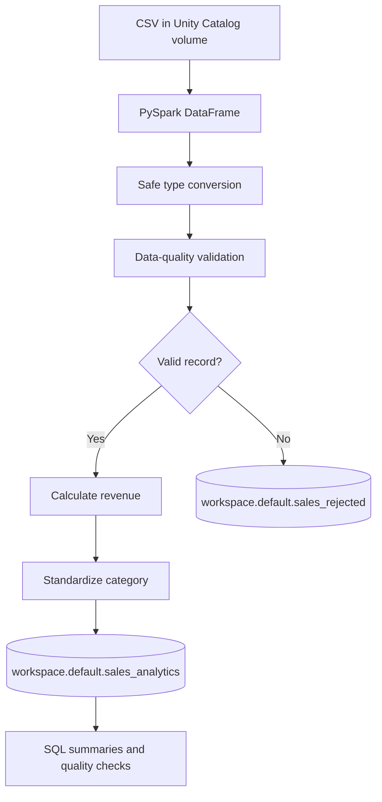

# Architecture — Databricks Sales Data Engineering Pipeline

## Purpose

Transform a raw sales CSV into validated, analytics-ready Delta tables using PySpark on Databricks.

## Pipeline Steps

1. **Ingestion:** Read the CSV from a Unity Catalog volume.
2. **Type conversion:** Safely cast order IDs, quantities, and prices; parse dates. Malformed values become null and can be identified.
3. **Validation:** Reject rows with missing/invalid order IDs, non-positive quantities, invalid/NaN/negative prices, or missing/invalid dates.
4. **Transformation:** Calculate `revenue = quantity * unit_price` for valid records.
5. **Standardization:** Trim category values, normalize capitalization, and label missing categories `Unknown`.
6. **Storage:** Write valid and rejected rows to separate Delta tables.
7. **Analysis:** Use Spark SQL to verify counts, check revenue quality, and aggregate revenue by category.

## Diagram

## Observed Data Quality Results

| Metric | Result |
|---|---:|
| Input rows | 1,000 |
| Valid rows | 988 |
| Rejected rows | 12 |
| Valid retention | 98.8% |

## Output Tables

- `workspace.default.sales_analytics`: validated sales records with calculated revenue.
- `workspace.default.sales_rejected`: records retained for data-quality review.

## Operational Considerations

Update the volume path when reproducing the project in another workspace. Confirm table permissions before writing to Unity Catalog. For production use, add automated tests, job scheduling, monitoring, and a documented policy for duplicates and schema changes.
